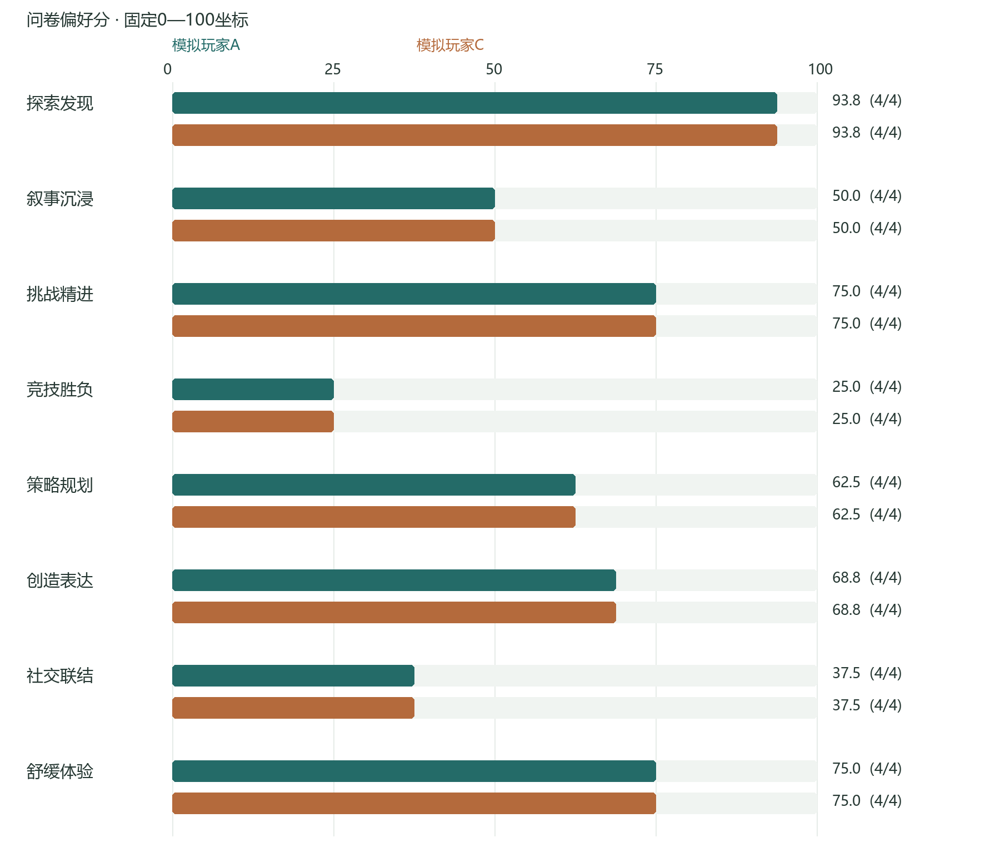

# 游格双人对照 模拟玩家A与模拟玩家C

**虚构模拟对照；不代表真实玩家、研究数据或契合度验证。**

共同作品和画像分开比较；没有性格契合度百分比。未列出的作品不等于不喜欢，“需要协调”只表示本次安排尚待确认。

## 共同喜欢的作品与各自原因

本次清单没有同作品同版本的重合；不能据此推断双方口味相反或性格不同。

## 独立测得的八维画像

分数只来自双方各自的核心题。差异不是合作能力评价。

| 维度 | 左侧分数／有效题数 | 右侧分数／有效题数 |
|---|---:|---:|
| 探索发现 | 93.8 / 4 | 93.8 / 4 |
| 叙事沉浸 | 50.0 / 4 | 50.0 / 4 |
| 挑战精进 | 75.0 / 4 | 75.0 / 4 |
| 竞技胜负 | 25.0 / 4 | 25.0 / 4 |
| 策略规划 | 62.5 / 4 | 62.5 / 4 |
| 创造表达 | 68.8 / 4 | 68.8 / 4 |
| 社交联结 | 37.5 / 4 | 37.5 / 4 |
| 舒缓体验 | 75.0 / 4 | 75.0 / 4 |

## 一起玩之前的协商事项

### 剧透：已有共同选择

左侧：回避提前知道剧情和谜底。

右侧：回避提前知道剧情和谜底。

目前双方都明确允许的范围是：仅机制与操作，先不展开剧情和谜底。额外内容由想了解的一方单独查看；扩大共享范围前再确认。

规则：`PAIR_SPOILER`；证据：left:answer:G02、right:answer:G02。

### 剧情：需要协调

左侧：各自看完需要的剧情再汇合。

右侧：共同停下来体验剧情。

双方在“剧情”的直接回答不同；先确认本次采用哪种安排，差异不等于性格冲突。

规则：`PAIR_STORY`；证据：left:answer:P02、right:answer:P02。

### 难度：需要协调

左侧：选择过程中可以随时调整的难度。

右侧：选择能比较从容体验的难度。

双方在“难度”的直接回答不同；先确认本次采用哪种安排，差异不等于性格冲突。

规则：`PAIR_DIFFICULTY`；证据：left:answer:P03、right:answer:P03。

### 探索推进：需要协调

左侧：遇到好奇内容时临时绕路。

右侧：事先约定探索和推进的时段。

双方在“探索推进”的直接回答不同；先确认本次采用哪种安排，差异不等于性格冲突。

规则：`PAIR_EXPLORATION`；证据：left:answer:P01、right:answer:P01。

### 攻略：需要协调

左侧：理解机制或操作规则、减少重复试错。

右侧：理解机制或操作规则、查漏补缺。

先比较双方查资料的用途，再共同约定查阅时机；剧情与谜底范围以剧透协商项为准。

规则：`PAIR_GUIDE`；证据：left:answer:G01、right:answer:G01。

### Mod：需要协调

左侧：有适用作品和条件，实际使用过Mod。

右侧：常用平台或版本不支持我想用的Mod。

至少一方报告Mod条件受限。先核对双方平台、版本和可行方案，未确认前以双方都能参与的内容为准。

规则：`PAIR_MOD`；证据：left:answer:M01、right:answer:M01。

### 失败后的安排：需要协调

左侧：先交流情况、调整方案。

右侧：先暂停休息。

双方在“失败后的安排”的直接回答不同；先确认本次采用哪种安排，差异不等于性格冲突。

规则：`PAIR_FAILURE`；证据：left:answer:P04、right:answer:P04。
