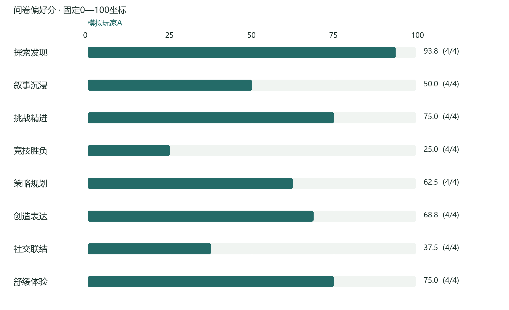

# 游格玩家偏好报告 模拟玩家A

**虚构模拟报告：玩家、答卷及其口味原因均为人工构造，不是研究样本。**

版本：题库 0.2.0；计分 0.2.0；文案 0.2.0；作品字典 0.2.0。

## 原型摘要

**迷雾探险家**

你更在意沿途还有什么没见过。

副偏好候选（不排序）：极限攀登者、自由造物者、自在栖居者。

主型在本次单题检查中保持不变，但副偏好可能变化；副偏好暂不排序。

行为标签：查机制，保留剧情与谜底；有二刷意愿，时间受限；先试再参考。

- 查机制，保留剧情与谜底：G01：理解机制或操作规则、减少重复试错；G02：回避提前知道剧情和谜底。

- 有二刷意愿，时间受限：R01：通常愿意；R03：有一定时间限制。

- 先试再参考：A01：先自己试，再在需要时参考资料。

摘要依据：下方八维分数与有效题数；称号仅为连续画像的展示摘要。

## 具体判断与答案依据

### 判断 1

你对发现未知内容有兴趣，也愿意借助资料理解机制，并且明确回避提前得知剧情与谜底。这里需要区分的是查规则与看答案，而不是简单地把探索和攻略放在两端。

依据：EXP01「未知路线」＝5（非常符合）；EXP02「没有明确奖励的新发现」＝5（非常符合）；EXP03「未说明的互动」＝5（非常符合）；EXP04「意外内容」＝4（比较符合）；探索发现＝93.8，有效4/4题；G01：理解机制或操作规则、减少重复试错；G02：回避提前知道剧情和谜底。

规则：`I_EXP_GUIDE`。

### 判断 2

练习带来的进展和从容的游戏过程都对你有吸引力。一次游玩可以偏重突破，另一次偏重节奏自主；这些答案本身并没有说明你一定要在挑战后休息。

依据：MAS01「自设挑战」＝4（比较符合）；MAS02「困难环节练习」＝4（比较符合）；MAS03「改善自己的表现」＝4（比较符合）；MAS04「逐步掌握技巧」＝4（比较符合）；挑战精进＝75.0，有效4/4题；CAL01「精力充足时的从容体验」＝4（比较符合）；CAL02「节奏自主」＝4（比较符合）；CAL03「安稳熟悉的过程」＝4（比较符合）；CAL04「失误后仍可从容体验」＝4（比较符合）；舒缓体验＝75.0，有效4/4题。

规则：`I_MAS_CAL`。

### 判断 3

你在条件合适时有再次体验的意愿，但实际可支配时间形成了限制。即使实际二刷较少，也不能据此解释成对二刷没有兴趣。

依据：R01：通常愿意；R03：有一定时间限制。

规则：`I_REPLAY_LIMITED`。

## 八维问卷偏好分

固定0—100坐标；分数不是百分位、能力分或人格准确率。

| 维度 | 分数 | 有效题数 |
|---|---:|---:|
| 探索发现 | 93.8 | 4/4 |
| 叙事沉浸 | 50.0 | 4/4 |
| 挑战精进 | 75.0 | 4/4 |
| 竞技胜负 | 25.0 | 4/4 |
| 策略规划 | 62.5 | 4/4 |
| 创造表达 | 68.8 | 4/4 |
| 社交联结 | 37.5 | 4/4 |
| 舒缓体验 | 75.0 | 4/4 |

## 你喜欢的这些游戏有什么共同点

这些是玩家自述的作品吸引点；它们不参与八维计分，也不证明现实人格。

| 喜欢的作品 | 体验状态 | 自填吸引点 |
|---|---|---|
| Elden Ring | 亲自体验过 | 未知发现、练习与突破 |
| Stardew Valley | 亲自体验过 | 未知发现、舒缓节奏 |
| Slay the Spire | 亲自体验过 | 练习与突破、机制与策略 |

你在亲自体验的《Elden Ring》、《Stardew Valley》中都选择了“未知发现”。这是这些作品对你重复出现的吸引点，依据来自你填写的原因。

依据：《Elden Ring》：未知发现；《Stardew Valley》：未知发现。

规则：`T_REPEAT_PLAYED`。

你在亲自体验的《Elden Ring》、《Slay the Spire》中都选择了“练习与突破”。这是这些作品对你重复出现的吸引点，依据来自你填写的原因。

依据：《Elden Ring》：练习与突破；《Slay the Spire》：练习与突破。

规则：`T_REPEAT_PLAYED`。

作品原因中重复出现“未知发现”，独立情境题的“探索发现”分数也较高。这里并列记录两份自述的呼应，不把吻合当作测量有效的证明。

依据：《Elden Ring》：未知发现；《Stardew Valley》：未知发现；探索发现＝93.8，有效4/4题。

规则：`T_ECHO`。

作品原因中重复出现“练习与突破”，独立情境题的“挑战精进”分数也较高。这里并列记录两份自述的呼应，不把吻合当作测量有效的证明。

依据：《Elden Ring》：练习与突破；《Slay the Spire》：练习与突破；挑战精进＝75.0，有效4/4题。

规则：`T_ECHO`。

玩家原话《Elden Ring》：“喜欢自己找到新区域，但机制不清楚时会查资料。”

玩家原话；未解析为计分或人格证据。

## 容易享受的体验与需要留意的体验

### 有明确支持的吸引点

遇到陌生路线、未说明互动或意外内容时，有继续了解的兴趣。

依据：EXP01「未知路线」＝5（非常符合）；EXP02「没有明确奖励的新发现」＝5（非常符合）；EXP03「未说明的互动」＝5（非常符合）；EXP04「意外内容」＝4（比较符合）；探索发现＝93.8，有效4/4题。

规则：`E_EXP_HIGH`。

能观察练习进展、改善自身表现或逐步掌握技巧的内容。

依据：MAS01「自设挑战」＝4（比较符合）；MAS02「困难环节练习」＝4（比较符合）；MAS03「改善自己的表现」＝4（比较符合）；MAS04「逐步掌握技巧」＝4（比较符合）；挑战精进＝75.0，有效4/4题。

规则：`E_MAS_HIGH`。

节奏可控、安稳熟悉、可从容体验的内容。

依据：CAL01「精力充足时的从容体验」＝4（比较符合）；CAL02「节奏自主」＝4（比较符合）；CAL03「安稳熟悉的过程」＝4（比较符合）；CAL04「失误后仍可从容体验」＝4（比较符合）；舒缓体验＝75.0，有效4/4题。

规则：`E_CAL_HIGH`。

补充体验清单：

- 操作手感（依据：补充清单明确选择；不计入八维）。

- 视听氛围（依据：补充清单明确选择；不计入八维）。

- 随机惊喜（依据：补充清单明确选择；不计入八维）。

### 有明确依据的消耗点或条件

你明确设置了剧透边界。提前提供超出边界的剧情或谜底，是需要避免的体验安排。

依据：G02：回避提前知道剧情和谜底。

规则：`D_SPOILER`。

## 具体同游建议

有直接回答时，建议按这些边界协商；资料不足的项目只是待确认事项。

### 剧透

先交流机制或操作；涉及剧情和谜底时，得到同意后再展开。

依据：G02：回避提前知道剧情和谜底。

### 剧情

约定剧情各自体验后，在同一个进度点汇合。

依据：P02：各自看完需要的剧情再汇合。

### 难度

优先确认当前模式是否允许中途调整，以及谁来提出调整。

依据：P03：选择过程中可以随时调整的难度。

### 探索推进

允许遇到好奇内容时提出绕路，同时确认队友是否愿意同行。

依据：P01：遇到好奇内容时临时绕路。

### 攻略

你选择的用途是“理解机制或操作规则、减少重复试错”。一起玩前先约定什么时候查、由谁查，并另行确认剧透边界。

依据：G01：理解机制或操作规则、减少重复试错。

### Mod

先列出实际要使用的Mod，确认双方版本、兼容性和改动范围。 本次用途依据为“这些用途是实际使用过的：修复问题或使用更方便、扩展可体验的内容”；假设意愿不表示已有安装或使用经历。

依据：M01：有适用作品和条件，实际使用过Mod；M02：这些用途是实际使用过的：修复问题或使用更方便、扩展可体验的内容。

### 失败后的安排

连续失败后先交流情况，再共同决定新的方案。

依据：P04：先交流情况、调整方案。

## 现实习惯自我核对

下面仅是自我核对问题，不计分，也不直接形成现实人格结论。

游戏之外，接触新事物时，你也常采用相似的起步方式吗？

依据：A01：先自己试，再在需要时参考资料。

规则：`SELF_APPROACH`。

在游戏之外，遇到没有明确收益的新事物时，你也会想了解吗？

依据：EXP01「未知路线」＝5（非常符合）；EXP02「没有明确奖励的新发现」＝5（非常符合）；EXP03「未说明的互动」＝5（非常符合）；EXP04「意外内容」＝4（比较符合）；探索发现＝93.8，有效4/4题。

规则：`SELF_EXP`。

## 原始答卷与逐维复算

只用有效核心答案求平均。每维至少三题有效；null不计入分母。

| 维度 | 四题原始答案，按01—04 | 有效总和／题数 | 平均分 | 25×平均分减25 |
|---|---|---:|---:|---:|
| 探索发现 | EXP01=5，EXP02=5，EXP03=5，EXP04=4 | 19/4 | 4.75 | 93.8 |
| 叙事沉浸 | NAR01=3，NAR02=3，NAR03=3，NAR04=3 | 12/4 | 3 | 50.0 |
| 挑战精进 | MAS01=4，MAS02=4，MAS03=4，MAS04=4 | 16/4 | 4 | 75.0 |
| 竞技胜负 | COM01=2，COM02=2，COM03=2，COM04=2 | 8/4 | 2 | 25.0 |
| 策略规划 | STR01=4，STR02=4，STR03=3，STR04=3 | 14/4 | 3.5 | 62.5 |
| 创造表达 | CRE01=4，CRE02=4，CRE03=4，CRE04=3 | 15/4 | 3.75 | 68.8 |
| 社交联结 | SOC01=3，SOC02=3，SOC03=2，SOC04=2 | 10/4 | 2.5 | 37.5 |
| 舒缓体验 | CAL01=4，CAL02=4，CAL03=4，CAL04=4 | 16/4 | 4 | 75.0 |

### 条件追问原始选择

| 题号 | 状态 | 实际答案 |
|---|---|---|
| G01 | 已回答 | 理解机制或操作规则、减少重复试错 |
| G02 | 已回答 | 回避提前知道剧情和谜底 |
| R01 | 已回答 | 通常愿意 |
| R02 | 已回答 | 体验新分支或不同路线、尝试新打法或进一步掌握技巧 |
| R03 | 已回答 | 有一定时间限制 |
| P01 | 已回答 | 遇到好奇内容时临时绕路 |
| P02 | 已回答 | 各自看完需要的剧情再汇合 |
| P03 | 已回答 | 选择过程中可以随时调整的难度 |
| P04 | 已回答 | 先交流情况、调整方案 |
| A01 | 已回答 | 先自己试，再在需要时参考资料 |
| M01 | 已回答 | 有适用作品和条件，实际使用过Mod |
| M02 | 已回答 | 这些用途是实际使用过的：修复问题或使用更方便、扩展可体验的内容 |

### 单题敏感性与答题分布

枚举了61个合法单题变化；主型或领先组保持不变；副偏好可能改变。

仅检查称号对单题小幅变化的敏感性，不是准确率、置信度或重测概率。

有效核心答案32/32；中立答案9；1—5分分布：{"1": 0, "2": 6, "3": 9, "4": 14, "5": 3}。

可人工核对的变化示例：

| 题号 | 原答案→新答案 | 主型或领先组改变 | 副偏好改变 |
|---|---|---|---|
| CRE01 | 4→5 | 否 | 是 |
| MAS01 | 4→3 | 否 | 是 |
| MAS01 | 4→5 | 否 | 是 |
| CAL01 | 4→3 | 否 | 是 |
| CAL01 | 4→5 | 否 | 是 |
| CAL02 | 4→3 | 否 | 是 |
| CAL02 | 4→5 | 否 | 是 |
| MAS02 | 4→3 | 否 | 是 |

完整变化列表保存在同名JSON报告中。

## 解释范围

- 八维是待验证的原创模型；称号与阈值均为展示规则。
- 分数描述通常游戏偏好，不是能力、品德或现实人格结论。
- 低偏好不自动等于厌恶；未选择和未回答不等于不喜欢。
- 模拟案例只检查规则一致性，不提供假设成立的证据。

答卷与版本指纹：`036f7dd5adc24f631079e6577b2bd43d06ddbe329cfbf6cbf5b27288f856a7ce`。
