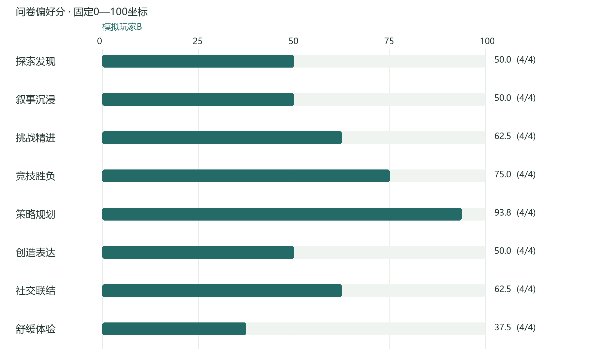

# 游格玩家偏好报告 模拟玩家B

**虚构模拟报告：玩家、答卷及其口味原因均为人工构造，不是研究样本。**

版本：题库 0.2.0；计分 0.2.0；文案 0.2.0；作品字典 0.2.0。

## 原型摘要

**策略规划师**

理解系统怎样运转，本身就是乐趣的一部分。

副偏好：赛场逐胜者。

行为标签：参考成熟方案。

- 参考成熟方案：G01：查漏补缺、参考成熟搭配或方案。

摘要依据：下方八维分数与有效题数；称号仅为连续画像的展示摘要。

## 具体判断与答案依据

### 判断 1

即使时间通常允许，你也更倾向于接触新作品或结束已有体验。这与想二刷但腾不出时间，是不同的选择。

依据：R01：通常更愿意接触新作品；R03：通常没有明显时间限制。

规则：`I_REPLAY_NOT_INTERESTED`。

### 判断 2

你对竞争反馈有兴趣；这不能说明你如何对待队友或输赢。

依据：COM01「直接对抗」＝4（比较符合）；COM02「异步纪录」＝4（比较符合）；COM03「队伍竞争」＝4（比较符合）；COM04「围绕胜负准备」＝4（比较符合）；竞技胜负＝75.0，有效4/4题。

规则：`I_COM_HIGH`。

### 判断 3

你会关注方案与结果的联系；参考攻略还是自行尝试是另一项具体习惯。

依据：STR01「机制与结果」＝5（非常符合）；STR02「资源安排」＝5（非常符合）；STR03「多步骤规划」＝5（非常符合）；STR04「方案优化」＝4（比较符合）；策略规划＝93.8，有效4/4题。

规则：`I_STR_HIGH`。

## 八维问卷偏好分

固定0—100坐标；分数不是百分位、能力分或人格准确率。

| 维度 | 分数 | 有效题数 |
|---|---:|---:|
| 探索发现 | 50.0 | 4/4 |
| 叙事沉浸 | 50.0 | 4/4 |
| 挑战精进 | 62.5 | 4/4 |
| 竞技胜负 | 75.0 | 4/4 |
| 策略规划 | 93.8 | 4/4 |
| 创造表达 | 50.0 | 4/4 |
| 社交联结 | 62.5 | 4/4 |
| 舒缓体验 | 37.5 | 4/4 |

## 你喜欢的这些游戏有什么共同点

这些是玩家自述的作品吸引点；它们不参与八维计分，也不证明现实人格。

| 喜欢的作品 | 体验状态 | 自填吸引点 |
|---|---|---|
| Elden Ring | 亲自体验过 | 机制与策略、数值成长 |
| Stardew Valley | 亲自体验过 | 机制与策略、收集补全 |
| Slay the Spire | 亲自体验过 | 机制与策略、数值成长 |

你在亲自体验的《Elden Ring》、《Stardew Valley》、《Slay the Spire》中都选择了“机制与策略”。这是这些作品对你重复出现的吸引点，依据来自你填写的原因。

依据：《Elden Ring》：机制与策略；《Stardew Valley》：机制与策略；《Slay the Spire》：机制与策略。

规则：`T_REPEAT_PLAYED`。

你在亲自体验的《Elden Ring》、《Slay the Spire》中都选择了“数值成长”。这是这些作品对你重复出现的吸引点，依据来自你填写的原因。

依据：《Elden Ring》：数值成长；《Slay the Spire》：数值成长。

规则：`T_REPEAT_PLAYED`。

作品原因中重复出现“机制与策略”，独立情境题的“策略规划”分数也较高。这里并列记录两份自述的呼应，不把吻合当作测量有效的证明。

依据：《Elden Ring》：机制与策略；《Stardew Valley》：机制与策略；《Slay the Spire》：机制与策略；策略规划＝93.8，有效4/4题。

规则：`T_ECHO`。

玩家原话《虚构试玩作品：急行日记》：“这次没有喜欢起来，只针对这款虚构作品。”

未喜欢作品的原话；仅用于该作品。

## 容易享受的体验与需要留意的体验

### 有明确支持的吸引点

直接对抗、队伍竞争或异步纪录比较的体验。

依据：COM01「直接对抗」＝4（比较符合）；COM02「异步纪录」＝4（比较符合）；COM03「队伍竞争」＝4（比较符合）；COM04「围绕胜负准备」＝4（比较符合）；竞技胜负＝75.0，有效4/4题。

规则：`E_COM_HIGH`。

可分析机制、安排资源、规划步骤并比较方案的内容。

依据：STR01「机制与结果」＝5（非常符合）；STR02「资源安排」＝5（非常符合）；STR03「多步骤规划」＝5（非常符合）；STR04「方案优化」＝4（比较符合）；策略规划＝93.8，有效4/4题。

规则：`E_STR_HIGH`。

补充体验清单：

- 即时爽感（依据：补充清单明确选择；不计入八维）。

- 数值成长（依据：补充清单明确选择；不计入八维）。

- 收集补全（依据：补充清单明确选择；不计入八维）。

### 有明确依据的消耗点或条件

你在亲自玩过但没有喜欢起来的《虚构试玩作品：急行日记》中选择了“节奏体验不合”。这说明该作品有需要留意的体验或条件，不自动泛化到所有同类作品。

依据：《虚构试玩作品：急行日记》：节奏体验不合。

规则：`D_NEGATIVE_GAME`。

你在亲自玩过但没有喜欢起来的《虚构试玩作品：急行日记》中选择了“技术问题影响体验”。这说明该作品有需要留意的体验或条件，不自动泛化到所有同类作品。

依据：《虚构试玩作品：急行日记》：技术问题影响体验。

规则：`D_NEGATIVE_GAME`。

## 具体同游建议

有直接回答时，建议按这些边界协商；资料不足的项目只是待确认事项。

### 剧透

你允许提前知道剧情和谜底；向同游者提供这些内容前，仍需确认对方边界。

依据：G02：剧情和谜底都可提前知道。

### 剧情

仅在双方都同意时略过剧情。

依据：P02：双方都同意时快速略过。

### 难度

共同选一个愿意练习的难度，并先约定什么时候讨论调整。

依据：P03：选择需要练习和尝试的难度。

### 探索推进

先明确本次推进目标，再约定遇到支线时是否停留。

依据：P01：先推进约定的目标。

### 攻略

你选择的用途是“查漏补缺、参考成熟搭配或方案”。一起玩前先约定什么时候查、由谁查，并另行确认剧透边界。

依据：G01：查漏补缺、参考成熟搭配或方案。

### Mod

如考虑使用Mod，先确认用途、安装条件和双方同意的范围。 本次用途依据为“这些用途是条件允许时愿意尝试的：修复问题或使用更方便、调整画面、外观或风格”；假设意愿不表示已有安装或使用经历。

依据：M01：有适用作品和条件，目前还没有使用；M02：这些用途是条件允许时愿意尝试的：修复问题或使用更方便、调整画面、外观或风格。

### 失败后的安排

提前约定连续尝试到何时再共同讨论下一步。

依据：P04：继续尝试。

## 现实习惯自我核对

下面仅是自我核对问题，不计分，也不直接形成现实人格结论。

游戏之外，接触新事物时，你也常采用相似的起步方式吗？

依据：A01：先参考成熟方案，再决定怎样用。

规则：`SELF_APPROACH`。

游戏之外，与别人比较表现也会增加你的参与兴趣吗？

依据：COM01「直接对抗」＝4（比较符合）；COM02「异步纪录」＝4（比较符合）；COM03「队伍竞争」＝4（比较符合）；COM04「围绕胜负准备」＝4（比较符合）；竞技胜负＝75.0，有效4/4题。

规则：`SELF_COM`。

## 原始答卷与逐维复算

只用有效核心答案求平均。每维至少三题有效；null不计入分母。

| 维度 | 四题原始答案，按01—04 | 有效总和／题数 | 平均分 | 25×平均分减25 |
|---|---|---:|---:|---:|
| 探索发现 | EXP01=3，EXP02=3，EXP03=3，EXP04=3 | 12/4 | 3 | 50.0 |
| 叙事沉浸 | NAR01=3，NAR02=3，NAR03=3，NAR04=3 | 12/4 | 3 | 50.0 |
| 挑战精进 | MAS01=4，MAS02=4，MAS03=3，MAS04=3 | 14/4 | 3.5 | 62.5 |
| 竞技胜负 | COM01=4，COM02=4，COM03=4，COM04=4 | 16/4 | 4 | 75.0 |
| 策略规划 | STR01=5，STR02=5，STR03=5，STR04=4 | 19/4 | 4.75 | 93.8 |
| 创造表达 | CRE01=3，CRE02=3，CRE03=3，CRE04=3 | 12/4 | 3 | 50.0 |
| 社交联结 | SOC01=4，SOC02=4，SOC03=3，SOC04=3 | 14/4 | 3.5 | 62.5 |
| 舒缓体验 | CAL01=3，CAL02=3，CAL03=2，CAL04=2 | 10/4 | 2.5 | 37.5 |

### 条件追问原始选择

| 题号 | 状态 | 实际答案 |
|---|---|---|
| G01 | 已回答 | 查漏补缺、参考成熟搭配或方案 |
| G02 | 已回答 | 剧情和谜底都可提前知道 |
| R01 | 已回答 | 通常更愿意接触新作品 |
| R02 | 已回答 | 更想把机会留给新作品、已有体验对我来说已经足够 |
| R03 | 已回答 | 通常没有明显时间限制 |
| P01 | 已回答 | 先推进约定的目标 |
| P02 | 已回答 | 双方都同意时快速略过 |
| P03 | 已回答 | 选择需要练习和尝试的难度 |
| P04 | 已回答 | 继续尝试 |
| A01 | 已回答 | 先参考成熟方案，再决定怎样用 |
| M01 | 已回答 | 有适用作品和条件，目前还没有使用 |
| M02 | 已回答 | 这些用途是条件允许时愿意尝试的：修复问题或使用更方便、调整画面、外观或风格 |

未喜欢作品：《虚构试玩作品：急行日记》；亲自体验；原因：节奏体验不合、技术问题影响体验。

### 单题敏感性与答题分布

枚举了61个合法单题变化；主型或领先组保持不变；副偏好保持不变。

仅检查称号对单题小幅变化的敏感性，不是准确率、置信度或重测概率。

有效核心答案32/32；中立答案18；1—5分分布：{"1": 0, "2": 2, "3": 18, "4": 9, "5": 3}。

## 解释范围

- 八维是待验证的原创模型；称号与阈值均为展示规则。
- 分数描述通常游戏偏好，不是能力、品德或现实人格结论。
- 低偏好不自动等于厌恶；未选择和未回答不等于不喜欢。
- 模拟案例只检查规则一致性，不提供假设成立的证据。

答卷与版本指纹：`ea97b8dd531277187a9047e90094fd83e7e92ffcff2731cb5ba29a12b97bc295`。
