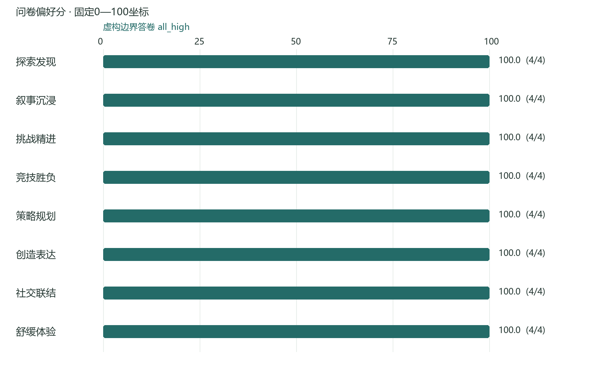

# 游格玩家偏好报告 虚构边界答卷 all_high

**虚构模拟报告：玩家、答卷及其口味原因均为人工构造，不是研究样本。**

版本：题库 0.2.0；计分 0.2.0；文案 0.2.0；作品字典 0.2.0。

## 原型摘要

**多面倾向：多种体验都有吸引力**

你对八类体验都给出了较高的问卷偏好分；本次不靠细小分差强排主副。

摘要依据：下方八维分数与有效题数；称号仅为连续画像的展示摘要。

## 具体判断与答案依据

### 判断 1

练习带来的进展和从容的游戏过程都对你有吸引力。一次游玩可以偏重突破，另一次偏重节奏自主；这些答案本身并没有说明你一定要在挑战后休息。

依据：MAS01「自设挑战」＝5（非常符合）；MAS02「困难环节练习」＝5（非常符合）；MAS03「改善自己的表现」＝5（非常符合）；MAS04「逐步掌握技巧」＝5（非常符合）；挑战精进＝100.0，有效4/4题；CAL01「精力充足时的从容体验」＝5（非常符合）；CAL02「节奏自主」＝5（非常符合）；CAL03「安稳熟悉的过程」＝5（非常符合）；CAL04「失误后仍可从容体验」＝5（非常符合）；舒缓体验＝100.0，有效4/4题。

规则：`I_MAS_CAL`。

### 判断 2

你既会关注机制和方案效果，也在意表达自己的风格。选一套有效方案与把它改成自己想要的样子，可以是两种同时存在的乐趣。

依据：STR01「机制与结果」＝5（非常符合）；STR02「资源安排」＝5（非常符合）；STR03「多步骤规划」＝5（非常符合）；STR04「方案优化」＝5（非常符合）；策略规划＝100.0，有效4/4题；CRE01「角色风格」＝5（非常符合）；CRE02「空间表达」＝5（非常符合）；CRE03「玩法表达」＝5（非常符合）；CRE04「自定主题」＝5（非常符合）；创造表达＝100.0，有效4/4题。

规则：`I_STR_CRE`。

### 判断 3

你会为新发现留下空间；具体如何探索，仍要看作品和当次约定。

依据：EXP01「未知路线」＝5（非常符合）；EXP02「没有明确奖励的新发现」＝5（非常符合）；EXP03「未说明的互动」＝5（非常符合）；EXP04「意外内容」＝5（非常符合）；探索发现＝100.0，有效4/4题。

规则：`I_EXP_HIGH`。

## 八维问卷偏好分

固定0—100坐标；分数不是百分位、能力分或人格准确率。

| 维度 | 分数 | 有效题数 |
|---|---:|---:|
| 探索发现 | 100.0 | 4/4 |
| 叙事沉浸 | 100.0 | 4/4 |
| 挑战精进 | 100.0 | 4/4 |
| 竞技胜负 | 100.0 | 4/4 |
| 策略规划 | 100.0 | 4/4 |
| 创造表达 | 100.0 | 4/4 |
| 社交联结 | 100.0 | 4/4 |
| 舒缓体验 | 100.0 | 4/4 |

## 你喜欢的这些游戏有什么共同点

本次没有填写喜欢作品，因此尚不能解释跨作品的共同吸引；核心画像照常独立计算。

## 容易享受的体验与需要留意的体验

### 有明确支持的吸引点

遇到陌生路线、未说明互动或意外内容时，有继续了解的兴趣。

依据：EXP01「未知路线」＝5（非常符合）；EXP02「没有明确奖励的新发现」＝5（非常符合）；EXP03「未说明的互动」＝5（非常符合）；EXP04「意外内容」＝5（非常符合）；探索发现＝100.0，有效4/4题。

规则：`E_EXP_HIGH`。

有角色动机、情节线索和可回味的人物关系的体验。

依据：NAR01「角色动机」＝5（非常符合）；NAR02「情节线索」＝5（非常符合）；NAR03「重要剧情停留」＝5（非常符合）；NAR04「回味人物关系」＝5（非常符合）；叙事沉浸＝100.0，有效4/4题。

规则：`E_NAR_HIGH`。

能观察练习进展、改善自身表现或逐步掌握技巧的内容。

依据：MAS01「自设挑战」＝5（非常符合）；MAS02「困难环节练习」＝5（非常符合）；MAS03「改善自己的表现」＝5（非常符合）；MAS04「逐步掌握技巧」＝5（非常符合）；挑战精进＝100.0，有效4/4题。

规则：`E_MAS_HIGH`。

直接对抗、队伍竞争或异步纪录比较的体验。

依据：COM01「直接对抗」＝5（非常符合）；COM02「异步纪录」＝5（非常符合）；COM03「队伍竞争」＝5（非常符合）；COM04「围绕胜负准备」＝5（非常符合）；竞技胜负＝100.0，有效4/4题。

规则：`E_COM_HIGH`。

可分析机制、安排资源、规划步骤并比较方案的内容。

依据：STR01「机制与结果」＝5（非常符合）；STR02「资源安排」＝5（非常符合）；STR03「多步骤规划」＝5（非常符合）；STR04「方案优化」＝5（非常符合）；策略规划＝100.0，有效4/4题。

规则：`E_STR_HIGH`。

能进行外观、空间、玩法风格或自定主题表达的内容。

依据：CRE01「角色风格」＝5（非常符合）；CRE02「空间表达」＝5（非常符合）；CRE03「玩法表达」＝5（非常符合）；CRE04「自定主题」＝5（非常符合）；创造表达＝100.0，有效4/4题。

规则：`E_CRE_HIGH`。

共同体验、分享经历和维系同好关系的机会。

依据：SOC01「共同体验」＝5（非常符合）；SOC02「维系联系」＝5（非常符合）；SOC03「分享经历」＝5（非常符合）；SOC04「结识同好」＝5（非常符合）；社交联结＝100.0，有效4/4题。

规则：`E_SOC_HIGH`。

节奏可控、安稳熟悉、可从容体验的内容。

依据：CAL01「精力充足时的从容体验」＝5（非常符合）；CAL02「节奏自主」＝5（非常符合）；CAL03「安稳熟悉的过程」＝5（非常符合）；CAL04「失误后仍可从容体验」＝5（非常符合）；舒缓体验＝100.0，有效4/4题。

规则：`E_CAL_HIGH`。

### 有明确依据的消耗点或条件

本次没有足够的明确回避或负面体验资料，暂不根据低分补写消耗点。

## 具体同游建议

有直接回答时，建议按这些边界协商；资料不足的项目只是待确认事项。

### 剧透

先确认这次允许透露的是机制、剧情还是谜底。

资料状态：未提供明确的可用选择；这不是对你的偏好判断。

### 剧情

开局前确认剧情是一起看、各自看，还是双方同意后略过。

资料状态：未提供明确的可用选择；这不是对你的偏好判断。

### 难度

共同确定初始难度和调整时机，不从偏好分推断技术水平。

资料状态：未提供明确的可用选择；这不是对你的偏好判断。

### 探索推进

先约定这次以推进目标还是探索沿途为主。

资料状态：未提供明确的可用选择；这不是对你的偏好判断。

### 攻略

先约定什么时候查资料、由谁查，以及哪些内容不能提前透露。

资料状态：未提供明确的可用选择；这不是对你的偏好判断。

### Mod

开始前确认平台、版本、可用Mod和双方接受的改动范围。

资料状态：未提供明确的可用选择；这不是对你的偏好判断。

### 失败后的安排

提前约定何时讨论继续、复盘、找提示、调整或暂停。

资料状态：未提供明确的可用选择；这不是对你的偏好判断。

## 现实习惯自我核对

下面仅是自我核对问题，不计分，也不直接形成现实人格结论。

在游戏之外，遇到没有明确收益的新事物时，你也会想了解吗？

依据：EXP01「未知路线」＝5（非常符合）；EXP02「没有明确奖励的新发现」＝5（非常符合）；EXP03「未说明的互动」＝5（非常符合）；EXP04「意外内容」＝5（非常符合）；探索发现＝100.0，有效4/4题。

规则：`SELF_EXP`。

游戏之外，你也会反复回味故事中人物的选择吗？

依据：NAR01「角色动机」＝5（非常符合）；NAR02「情节线索」＝5（非常符合）；NAR03「重要剧情停留」＝5（非常符合）；NAR04「回味人物关系」＝5（非常符合）；叙事沉浸＝100.0，有效4/4题。

规则：`SELF_NAR`。

## 原始答卷与逐维复算

只用有效核心答案求平均。每维至少三题有效；null不计入分母。

| 维度 | 四题原始答案，按01—04 | 有效总和／题数 | 平均分 | 25×平均分减25 |
|---|---|---:|---:|---:|
| 探索发现 | EXP01=5，EXP02=5，EXP03=5，EXP04=5 | 20/4 | 5 | 100.0 |
| 叙事沉浸 | NAR01=5，NAR02=5，NAR03=5，NAR04=5 | 20/4 | 5 | 100.0 |
| 挑战精进 | MAS01=5，MAS02=5，MAS03=5，MAS04=5 | 20/4 | 5 | 100.0 |
| 竞技胜负 | COM01=5，COM02=5，COM03=5，COM04=5 | 20/4 | 5 | 100.0 |
| 策略规划 | STR01=5，STR02=5，STR03=5，STR04=5 | 20/4 | 5 | 100.0 |
| 创造表达 | CRE01=5，CRE02=5，CRE03=5，CRE04=5 | 20/4 | 5 | 100.0 |
| 社交联结 | SOC01=5，SOC02=5，SOC03=5，SOC04=5 | 20/4 | 5 | 100.0 |
| 舒缓体验 | CAL01=5，CAL02=5，CAL03=5，CAL04=5 | 20/4 | 5 | 100.0 |

### 条件追问原始选择

| 题号 | 状态 | 实际答案 |
|---|---|---|
| G01 | 未声明适用性 | — |
| G02 | 未声明适用性 | — |
| R01 | 未声明适用性 | — |
| R02 | 未声明适用性 | — |
| R03 | 未声明适用性 | — |
| P01 | 未声明适用性 | — |
| P02 | 未声明适用性 | — |
| P03 | 未声明适用性 | — |
| P04 | 未声明适用性 | — |
| A01 | 未声明适用性 | — |
| M01 | 未声明适用性 | — |
| M02 | 未声明适用性 | — |

### 单题敏感性与答题分布

枚举了32个合法单题变化；主型或领先组保持不变；副偏好保持不变。

仅检查称号对单题小幅变化的敏感性，不是准确率、置信度或重测概率。

有效核心答案32/32；中立答案0；1—5分分布：{"1": 0, "2": 0, "3": 0, "4": 0, "5": 32}。

答案分布较集中；仅记录这一现象，不自动判定无效或不认真。

## 解释范围

- 八维是待验证的原创模型；称号与阈值均为展示规则。
- 分数描述通常游戏偏好，不是能力、品德或现实人格结论。
- 低偏好不自动等于厌恶；未选择和未回答不等于不喜欢。
- 模拟案例只检查规则一致性，不提供假设成立的证据。

答卷与版本指纹：`546bdc3fa1304df1daf484f0bc185289d7ca6b67bf3d419b3c92f39db28c7f02`。
