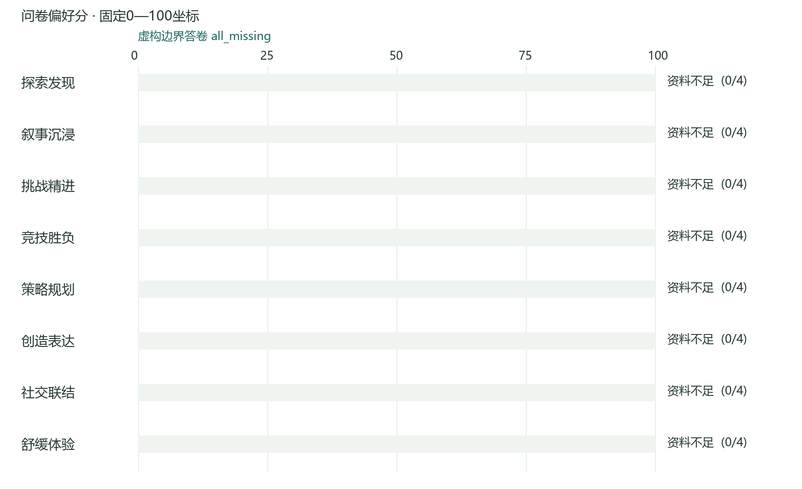

# 游格玩家偏好报告 虚构边界答卷 all_missing

**虚构模拟报告：玩家、答卷及其口味原因均为人工构造，不是研究样本。**

版本：题库 0.2.0；计分 0.2.0；文案 0.2.0；作品字典 0.2.0。

## 原型摘要

**局部偏好画像**

部分维度的有效答案不足三题，当前只解释有依据的局部偏好，暂缓完整主副称号。

摘要依据：下方八维分数与有效题数；称号仅为连续画像的展示摘要。

## 具体判断与答案依据

可用证据不足以支持三条具体判断，当前只保留有依据的内容。

## 八维问卷偏好分

固定0—100坐标；分数不是百分位、能力分或人格准确率。

| 维度 | 分数 | 有效题数 |
|---|---:|---:|
| 探索发现 | 资料不足 | 0/4 |
| 叙事沉浸 | 资料不足 | 0/4 |
| 挑战精进 | 资料不足 | 0/4 |
| 竞技胜负 | 资料不足 | 0/4 |
| 策略规划 | 资料不足 | 0/4 |
| 创造表达 | 资料不足 | 0/4 |
| 社交联结 | 资料不足 | 0/4 |
| 舒缓体验 | 资料不足 | 0/4 |

## 你喜欢的这些游戏有什么共同点

本次没有填写喜欢作品，因此尚不能解释跨作品的共同吸引；核心画像照常独立计算。

## 容易享受的体验与需要留意的体验

### 有明确支持的吸引点

本次尚无满足多场景证据条件的维度吸引点，保留具体回答供核对。

### 有明确依据的消耗点或条件

本次没有足够的明确回避或负面体验资料，暂不根据低分补写消耗点。

## 具体同游建议

有直接回答时，建议按这些边界协商；资料不足的项目只是待确认事项。

### 剧透

先确认这次允许透露的是机制、剧情还是谜底。

资料状态：未提供明确的可用选择；这不是对你的偏好判断。

### 剧情

开局前确认剧情是一起看、各自看，还是双方同意后略过。

资料状态：未提供明确的可用选择；这不是对你的偏好判断。

### 难度

共同确定初始难度和调整时机，不从偏好分推断技术水平。

资料状态：未提供明确的可用选择；这不是对你的偏好判断。

### 探索推进

先约定这次以推进目标还是探索沿途为主。

资料状态：未提供明确的可用选择；这不是对你的偏好判断。

### 攻略

先约定什么时候查资料、由谁查，以及哪些内容不能提前透露。

资料状态：未提供明确的可用选择；这不是对你的偏好判断。

### Mod

开始前确认平台、版本、可用Mod和双方接受的改动范围。

资料状态：未提供明确的可用选择；这不是对你的偏好判断。

### 失败后的安排

提前约定何时讨论继续、复盘、找提示、调整或暂停。

资料状态：未提供明确的可用选择；这不是对你的偏好判断。

## 现实习惯自我核对

下面仅是自我核对问题，不计分，也不直接形成现实人格结论。

当前没有足够依据生成个性化核对问题。

## 原始答卷与逐维复算

只用有效核心答案求平均。每维至少三题有效；null不计入分母。

| 维度 | 四题原始答案，按01—04 | 有效总和／题数 | 平均分 | 25×平均分减25 |
|---|---|---:|---:|---:|
| 探索发现 | EXP01=null，EXP02=null，EXP03=null，EXP04=null | 0/0 | — | 资料不足 |
| 叙事沉浸 | NAR01=null，NAR02=null，NAR03=null，NAR04=null | 0/0 | — | 资料不足 |
| 挑战精进 | MAS01=null，MAS02=null，MAS03=null，MAS04=null | 0/0 | — | 资料不足 |
| 竞技胜负 | COM01=null，COM02=null，COM03=null，COM04=null | 0/0 | — | 资料不足 |
| 策略规划 | STR01=null，STR02=null，STR03=null，STR04=null | 0/0 | — | 资料不足 |
| 创造表达 | CRE01=null，CRE02=null，CRE03=null，CRE04=null | 0/0 | — | 资料不足 |
| 社交联结 | SOC01=null，SOC02=null，SOC03=null，SOC04=null | 0/0 | — | 资料不足 |
| 舒缓体验 | CAL01=null，CAL02=null，CAL03=null，CAL04=null | 0/0 | — | 资料不足 |

### 条件追问原始选择

| 题号 | 状态 | 实际答案 |
|---|---|---|
| G01 | 未声明适用性 | — |
| G02 | 未声明适用性 | — |
| R01 | 未声明适用性 | — |
| R02 | 未声明适用性 | — |
| R03 | 未声明适用性 | — |
| P01 | 未声明适用性 | — |
| P02 | 未声明适用性 | — |
| P03 | 未声明适用性 | — |
| P04 | 未声明适用性 | — |
| A01 | 未声明适用性 | — |
| M01 | 未声明适用性 | — |
| M02 | 未声明适用性 | — |

### 单题敏感性与答题分布

枚举了0个有效答案的合法单题变化；完整画像仍有缺失，本次不评价完整称号是否稳定。

仅检查称号对单题小幅变化的敏感性，不是准确率、置信度或重测概率。

有效核心答案0/32；中立答案0；1—5分分布：{"1": 0, "2": 0, "3": 0, "4": 0, "5": 0}。

## 解释范围

- 八维是待验证的原创模型；称号与阈值均为展示规则。
- 分数描述通常游戏偏好，不是能力、品德或现实人格结论。
- 低偏好不自动等于厌恶；未选择和未回答不等于不喜欢。
- 模拟案例只检查规则一致性，不提供假设成立的证据。

答卷与版本指纹：`e9e76ef5b7d3aa389599e0fb9c5e17249ccb6d4235bdbe1c5a5397e7b241d296`。
