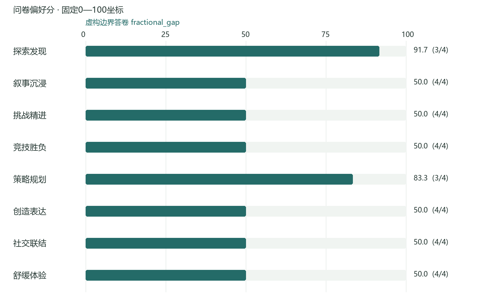

# 游格玩家偏好报告 虚构边界答卷 fractional_gap

**虚构模拟报告：玩家、答卷及其口味原因均为人工构造，不是研究样本。**

版本：题库 0.2.0；计分 0.2.0；文案 0.2.0；作品字典 0.2.0。

## 原型摘要

**暂定偏好组合**

单个答案小幅改变就可能改变主型或领先组；本次以分数和具体判断呈现偏好，暂不区分主副。

摘要依据：下方八维分数与有效题数；称号仅为连续画像的展示摘要。

## 具体判断与答案依据

### 判断 1

你会为新发现留下空间；具体如何探索，仍要看作品和当次约定。

依据：EXP01「未知路线」＝5（非常符合）；EXP02「没有明确奖励的新发现」＝5（非常符合）；EXP03「未说明的互动」＝4（比较符合）；探索发现＝91.7，有效3/4题。

规则：`I_EXP_HIGH`。

### 判断 2

你会关注方案与结果的联系；参考攻略还是自行尝试是另一项具体习惯。

依据：STR01「机制与结果」＝5（非常符合）；STR02「资源安排」＝4（比较符合）；STR03「多步骤规划」＝4（比较符合）；策略规划＝83.3，有效3/4题。

规则：`I_STR_HIGH`。

可用证据不足以支持三条具体判断，当前只保留有依据的内容。

## 八维问卷偏好分

固定0—100坐标；分数不是百分位、能力分或人格准确率。

| 维度 | 分数 | 有效题数 |
|---|---:|---:|
| 探索发现 | 91.7 | 3/4 |
| 叙事沉浸 | 50.0 | 4/4 |
| 挑战精进 | 50.0 | 4/4 |
| 竞技胜负 | 50.0 | 4/4 |
| 策略规划 | 83.3 | 3/4 |
| 创造表达 | 50.0 | 4/4 |
| 社交联结 | 50.0 | 4/4 |
| 舒缓体验 | 50.0 | 4/4 |

## 你喜欢的这些游戏有什么共同点

本次没有填写喜欢作品，因此尚不能解释跨作品的共同吸引；核心画像照常独立计算。

## 容易享受的体验与需要留意的体验

### 有明确支持的吸引点

遇到陌生路线、未说明互动或意外内容时，有继续了解的兴趣。

依据：EXP01「未知路线」＝5（非常符合）；EXP02「没有明确奖励的新发现」＝5（非常符合）；EXP03「未说明的互动」＝4（比较符合）；探索发现＝91.7，有效3/4题。

规则：`E_EXP_HIGH`。

可分析机制、安排资源、规划步骤并比较方案的内容。

依据：STR01「机制与结果」＝5（非常符合）；STR02「资源安排」＝4（比较符合）；STR03「多步骤规划」＝4（比较符合）；策略规划＝83.3，有效3/4题。

规则：`E_STR_HIGH`。

### 有明确依据的消耗点或条件

本次没有足够的明确回避或负面体验资料，暂不根据低分补写消耗点。

## 具体同游建议

有直接回答时，建议按这些边界协商；资料不足的项目只是待确认事项。

### 剧透

先确认这次允许透露的是机制、剧情还是谜底。

资料状态：未提供明确的可用选择；这不是对你的偏好判断。

### 剧情

开局前确认剧情是一起看、各自看，还是双方同意后略过。

资料状态：未提供明确的可用选择；这不是对你的偏好判断。

### 难度

共同确定初始难度和调整时机，不从偏好分推断技术水平。

资料状态：未提供明确的可用选择；这不是对你的偏好判断。

### 探索推进

先约定这次以推进目标还是探索沿途为主。

资料状态：未提供明确的可用选择；这不是对你的偏好判断。

### 攻略

先约定什么时候查资料、由谁查，以及哪些内容不能提前透露。

资料状态：未提供明确的可用选择；这不是对你的偏好判断。

### Mod

开始前确认平台、版本、可用Mod和双方接受的改动范围。

资料状态：未提供明确的可用选择；这不是对你的偏好判断。

### 失败后的安排

提前约定何时讨论继续、复盘、找提示、调整或暂停。

资料状态：未提供明确的可用选择；这不是对你的偏好判断。

## 现实习惯自我核对

下面仅是自我核对问题，不计分，也不直接形成现实人格结论。

在游戏之外，遇到没有明确收益的新事物时，你也会想了解吗？

依据：EXP01「未知路线」＝5（非常符合）；EXP02「没有明确奖励的新发现」＝5（非常符合）；EXP03「未说明的互动」＝4（比较符合）；探索发现＝91.7，有效3/4题。

规则：`SELF_EXP`。

游戏之外，你也享受比较几种方案如何影响结果吗？

依据：STR01「机制与结果」＝5（非常符合）；STR02「资源安排」＝4（比较符合）；STR03「多步骤规划」＝4（比较符合）；策略规划＝83.3，有效3/4题。

规则：`SELF_STR`。

## 原始答卷与逐维复算

只用有效核心答案求平均。每维至少三题有效；null不计入分母。

| 维度 | 四题原始答案，按01—04 | 有效总和／题数 | 平均分 | 25×平均分减25 |
|---|---|---:|---:|---:|
| 探索发现 | EXP01=5，EXP02=5，EXP03=4，EXP04=null | 14/3 | 4.666667 | 91.7 |
| 叙事沉浸 | NAR01=3，NAR02=3，NAR03=3，NAR04=3 | 12/4 | 3 | 50.0 |
| 挑战精进 | MAS01=3，MAS02=3，MAS03=3，MAS04=3 | 12/4 | 3 | 50.0 |
| 竞技胜负 | COM01=3，COM02=3，COM03=3，COM04=3 | 12/4 | 3 | 50.0 |
| 策略规划 | STR01=5，STR02=4，STR03=4，STR04=null | 13/3 | 4.333333 | 83.3 |
| 创造表达 | CRE01=3，CRE02=3，CRE03=3，CRE04=3 | 12/4 | 3 | 50.0 |
| 社交联结 | SOC01=3，SOC02=3，SOC03=3，SOC04=3 | 12/4 | 3 | 50.0 |
| 舒缓体验 | CAL01=3，CAL02=3，CAL03=3，CAL04=3 | 12/4 | 3 | 50.0 |

### 条件追问原始选择

| 题号 | 状态 | 实际答案 |
|---|---|---|
| G01 | 未声明适用性 | — |
| G02 | 未声明适用性 | — |
| R01 | 未声明适用性 | — |
| R02 | 未声明适用性 | — |
| R03 | 未声明适用性 | — |
| P01 | 未声明适用性 | — |
| P02 | 未声明适用性 | — |
| P03 | 未声明适用性 | — |
| P04 | 未声明适用性 | — |
| A01 | 未声明适用性 | — |
| M01 | 未声明适用性 | — |
| M02 | 未声明适用性 | — |

### 单题敏感性与答题分布

枚举了57个合法单题变化；主型或领先组可能改变；副偏好可能改变。

仅检查称号对单题小幅变化的敏感性，不是准确率、置信度或重测概率。

有效核心答案30/32；中立答案24；1—5分分布：{"1": 0, "2": 0, "3": 24, "4": 3, "5": 3}。

大多数有效回答选择了中立，整体可区分信息较少；仍保留明确的局部证据。

答案分布较集中；仅记录这一现象，不自动判定无效或不认真。

可人工核对的变化示例：

| 题号 | 原答案→新答案 | 主型或领先组改变 | 副偏好改变 |
|---|---|---|---|
| STR01 | 5→4 | 是 | 是 |
| STR02 | 4→3 | 是 | 是 |
| EXP03 | 4→5 | 是 | 是 |
| STR03 | 4→3 | 是 | 是 |

完整变化列表保存在同名JSON报告中。

## 解释范围

- 八维是待验证的原创模型；称号与阈值均为展示规则。
- 分数描述通常游戏偏好，不是能力、品德或现实人格结论。
- 低偏好不自动等于厌恶；未选择和未回答不等于不喜欢。
- 模拟案例只检查规则一致性，不提供假设成立的证据。

答卷与版本指纹：`87437428c434a340a3a51a637968f5b747ccd174446985f06be49fa8015aa2e0`。
